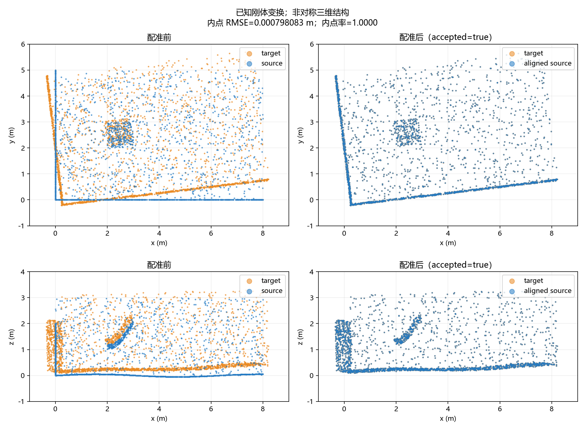
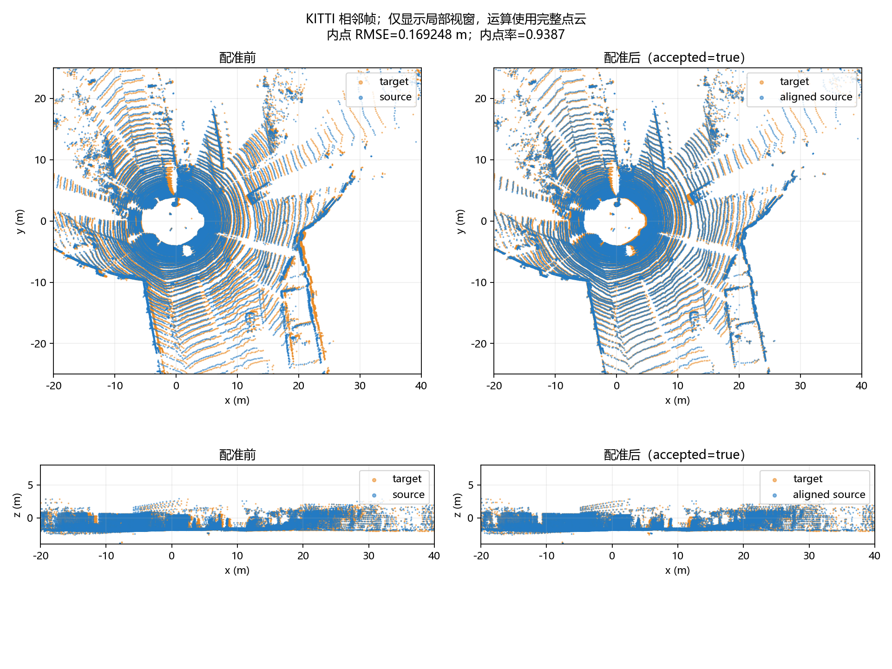

# 面向激光 SLAM 的 C++ 点云配准与相对位姿估计系统

`lidar-icp-localization` 是一个面向 C++/SLAM 学习与算法工程实践的两帧 LiDAR 点云配准项目。
使用 PCL 完成点云处理及 point-to-point ICP，使用 Eigen 表达和验证相对位姿。
**这是点云配准与相对位姿估计实践，不是完整 SLAM 系统，也不是 FAST-LIO 复现。**

当前 A/B/C 已在 main 集成并独立复验：全新 Release 构建、完整 **CTest 10/10**，
**35 组实际实验**（原模块 10 组 + 主对话 25 组有界参数/退化实验），六张真实结果图可追溯。
尚未完成独立质量审查和公开发布，源码最终 LICENSE/版权署名待确认。

## 功能与数据流

```text
PCD / KITTI BIN → XYZI PCD → XYZ 有限点清理 → 体素下采样
                 → 带初值的 PCL ICP → 独立质量门禁 → JSON 位姿/指标
                 → 实验 CSV、输入/二进制哈希、真实点云图、失败分析
```

- PCD 读取、NaN/Inf 剔除、体素质心、点数和范围统计，不信任错误的 is_dense 标志。
- source→target 变换、4×4 SE(3)、旋转/平移/四元数、fitness m²、内点 RMSE、内点率和 align 耗时。
- 人工已知刚体变换验证、BIN→PCD 字节保持检查、KITTI 两个相邻帧与参数对比。
- 未收敛和零/低内点率、高 RMSE 等结果拒绝输出有效位姿；保留诊断及失败退出码。
- 标准 CTest 不下载道路数据，不依赖 NumPy/Matplotlib；完整实验单独执行。

统一右手坐标、米、弧度、列向量：`p_target = T_target_source * p_source`。
车辆运动语义需要帧序、静态场景与外参等前提，不能把该矩阵无条件当作车辆实际运动。

## 技术栈与实测环境

| 项目 | 本机验证版本 |
|---|---|
| OS / 编译器 | Windows 11，MSYS2 UCRT64 GCC 16.2.0，x86_64，C++17 |
| 核心依赖 | PCL 1.15.1、独立 Eigen 3.4.0；Boost 1.92.0、FLANN 1.9.2、VTK 9.6.2 |
| 构建 / 测试 | CMake/CTest 3.31.6、Git；项目要求 CMake >=3.20 |
| 测试驱动 | Python >=3.9 标准库 |
| 可选实验绘图 | 实测 CPython 3.11.5、NumPy 2.4.4、Matplotlib 3.10.8、Agg 后端 |

依赖安装、固定源码提交和包版本见 [ENVIRONMENT](docs/ENVIRONMENT.md)。
保留已有 GCC，不能链接 MSVC 预编译 PCL；系统 Eigen 5 不用于该项目。
依赖不随仓库分发，按环境记录准备后可用 `tools/build_dependencies.ps1` 重建同工具链依赖。
其他平台未做实机验证，不承诺跨平台 PNG 或二进制哈希一致。

## 构建与自动化测试

在仓库根目录 PowerShell 执行：

```powershell
./tools/verify_dependencies.ps1 -BuildDirectory build-final-c -Jobs 1
```

脚本显式开启 PCL、配置 Release、构建和运行完整 CTest；仅临时设置 DLL PATH，结束后恢复。
已有本地依赖不重新下载或编译 PCL。依赖/CMake 不在默认位置时传 `-DependencyRoot`、`-CMake`、`-MsysRoot`。
10 项 CTest 包含 5 组实验工具检查、5 组归档损坏检测和 9 个 CLI 场景；内部场景不重复计入 CTest 总数。
日志见本机 `build/final-c-build.log`、`build/final-c-final-tests.log`。

默认 `LIDAR_ENABLE_PCL=OFF` 仅提供帮助/版本入口；正式功能必须使用上面的 ON 构建。
若只检查最小 C++17 工程，可运行 CMake OFF 构建和 3 项基础测试，不能据此宣称 ICP 验收通过。

## 运行单次配准

准备两个以米计量的 PCD 后，在上述构建基础上运行；路径按自己的数据替换：

```powershell
$savedPath = $env:Path
try {
  $ucrtBin = Split-Path -Parent (Get-Command g++.exe).Source
  $env:Path = "$((Resolve-Path .local-deps/pcl-1.15.1/bin).Path);$ucrtBin;$savedPath"
  # 首次下载和转换后的真实 KITTI 文件，见下一节。
  ./build-final-c/lidar_icp.exe --source data/kitti/drive_0005_pair/0000000001.pcd --target data/kitti/drive_0005_pair/0000000000.pcd --voxel-size 0.3 --max-iterations 100 --max-correspondence-distance 1 --evaluation-distance 0.5 --max-rmse 0.2 --output build-final-c/road-manual.json
} finally {
  $env:Path = $savedPath
}
```

stdout 为 JSON，处理日志为 stderr；已有输出文件会被拒绝覆盖。
`--initial`/`--truth` 接受无标题、严格 16 个数的逐行 4×4 SE(3) 矩阵；truth 仅评分，不参与初始化。
报告含配置、点数、`converged`、`accepted`、矩阵/位姿、匹配指标及可选真值误差。
**消费有效位姿必须检查 accepted**；拒绝结果的 pose/T_target_source 为 null，诊断矩阵另列。
默认至少 3 内点、内点率 >=0.5、内点 RMSE <=0.2 m；可按实验调整。
退出码：0 接受；2 输入非法；3 IO/运行错误；4 未收敛或质量拒绝。
详情见 [INTERFACES](docs/INTERFACES.md)。

## 数据与完整复现

人工数据为固定种子 20261027 的 2400 个非对称三维点，
`target=T_gt*source`，`R=Rz(0.12)*Ry(-0.035)*Rx(0.02)`、`t=(0.3,-0.15,0.08) m`。
生成器输出 PCD、真值和元信息，拒绝覆盖文件。

真实道路为 [KITTI Raw](https://www.cvlibs.net/datasets/kitti/raw_data.php)
`2011_09_26_drive_0005_sync`，source=帧 1、target=帧 0，间隔约 0.103288 s。
从 [AWS 公共数据登记](https://registry.opendata.aws/kitti/) 指定的官方公共桶 Range 获取约 4.15 MB，
不下载约 646 MB 整包。原始 BIN/转换 PCD 不纳入 Git。

首次下载及转换（已有文件不要重复执行）：

```powershell
python tools/fetch_kitti_pair.py --output data/kitti/drive_0005_pair
python tools/kitti_bin_to_pcd.py --input data/kitti/drive_0005_pair/0000000000.bin --output data/kitti/drive_0005_pair/0000000000.pcd
python tools/kitti_bin_to_pcd.py --input data/kitti/drive_0005_pair/0000000001.bin --output data/kitti/drive_0005_pair/0000000001.pcd
```

完整 35 组复现、DLL PATH 和绘图解释器设置见 [EXPERIMENTS](docs/EXPERIMENTS.md) 的 main 复验一节。
运行驱动加 `--sweep` 可重复 25 个参数/退化实验；每次为 work/output/figures 选择新目录，防止覆盖证据。
可选绘图包锁定于 `tools/requirements-experiments.txt`；本机复验使用已有包，没有修改环境。
没有下载数据时也能核验公开归档与六图：

```powershell
python tools/validate_experiments.py --metrics results/metrics/main-review --figures results/figures/module-c-v2 --reference results/metrics/module-c-v2 --skip-inputs
```

BIN 按 little-endian float32 XYZI 读取，非空且长度为 16 的整数倍，检查所有字段有限；
转为 binary PCD 时 payload 字节保持、intensity 保留，核心算法只消费 XYZ。
Velodyne 坐标 x 前、y 左、z 上，未隐式改轴、缩放或用相机/IMU标定，未额外做逐点运动补偿。

## main 实测结果

| 场景 | 平移误差 m | 旋转误差 rad | 内点 RMSE m | 内点率 | accepted |
|---|---:|---:|---:|---:|---|
| 人工，0.02 m 体素 | 3.04785e-5 | 3.69360e-6 | 0.000798083 | 1 | true |
| KITTI，0.1 m | 未测 | 未测 | 0.129406 | 96.59% | true |
| KITTI，0.3 m | 未测 | 未测 | 0.169248 | 93.87% | true |
| KITTI，0.6 m | 未测 | 未测 | 0.225686 | 90.16% | false，RMSE 超限 |

原 10 组在 main 新二进制下复验，除路径与耗时外报告全部一致。
35 组报告/命令/CSV、42 个输入哈希和六图来源见 [main 归档](results/metrics/main-review/REVIEW.md)。
**KITTI 内点 RMSE 不是车辆真实定位误差**；没有参考轨迹/外参真值，相关误差为 null，未宣称实车精度。
耗时只计一次 align，非 FPS/延迟基准；当前只验证一个道路帧对。

## 真实运行结果图

下图来自实际点云和 accepted 的估计矩阵，为 Matplotlib 数据图，不是 AI 图片，也不冒称 PCL GUI 截图。
ICP 使用完整清理/体素后的点云；道路图片只为显示裁剪和稀疏，前后视窗一致。
main 独立复绘六图的哈希与提交图完全相同。





其余四图：[人工原始点云](results/figures/module-c-v2/synthetic_raw.png)、
[KITTI 原始点云](results/figures/module-c-v2/kitti_raw.png)、
[人工真值误差](results/figures/module-c-v2/synthetic_errors.png)、
[体素参数对比](results/figures/module-c-v2/voxel_comparison.png)。

## 算法局限

- ICP 依赖初值、场景结构、动态物体和可匹配区域；未实现地图、回环、IMU、ROS 或多帧漂移分析。
- 数值门禁只反映局部几何匹配。main 的直线/对称平面反例在内点率 1、极小 RMSE 时仍分别产生约 90°/180°姿态歧义；
  `accepted=true` 不是正确位姿或可观测性的保证。
- 粗体素可能 accepted 却达不到人工真值精度；人工 0.3 m 体素旋转误差约 0.26557°，未达到 0.1°标准。
- 25 组单因素/退化扫描是有界证据，不是全随机种子、全部参数交互或全部真实道路条件的鲁棒性证明。
- 尚未验证 PCL 交互窗口渲染。第三方 GCC/Eigen/PCL 分配器警告保留，未屏蔽或修改依赖，未做完整内存检测器验证。

## 目录、协作与发布状态

```text
include/ src/       A/B、主程序及 registration_pipeline
tests/             A/B 与 CLI 测试
tools/             数据生成/下载/转换、实验驱动与离线验证
data/kitti/        本地真实数据（Git 忽略）
results/figures/   六张真实数据图及署名
results/metrics/   原模块归档和 main 独立复验归档
docs/              接口、实验、环境、任务、进度与审查记录
build*/            本地构建/原始复现数据与日志（Git 忽略）
```

模块所有权与独立 worktree 规范见 [AGENTS](AGENTS.md)、[WORKTREES](docs/WORKTREES.md)；
最新状态见 [TASKS](docs/TASKS.md)、[PROGRESS](docs/PROGRESS.md)。当前已具备独立质量审查条件。

KITTI 官方数据许可为 [CC BY-NC-SA 3.0](https://www.cvlibs.net/datasets/kitti/)。
道路派生图/结果保留原作者署名、改动说明、许可链接及非商业/相同方式共享条件，
见 [第三方说明](docs/THIRD_PARTY.md) 和图/指标目录 ATTRIBUTION.md，不能笼统套用候选 MIT。
本项目尚无最终源码 LICENSE；需确认版权署名/许可证，并完成独立审查后再公开发布。
用户明确批准之前不创建公开远程仓库、不推送。批准后按以下流程上传已经审核的提交：

```powershell
git remote add origin <approved-repository-url>
git push -u origin main
```
