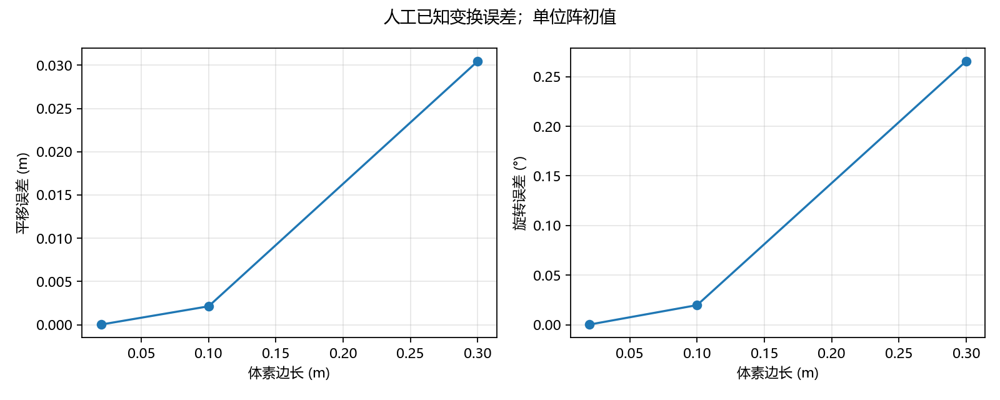

# 模块 C 实验记录与交付

日期：2026-10-27（Asia/Shanghai）。分支 `feature/experiments`，实验基线 `9fc3057d54d7072dbbbf7affdf07ac8cd3663e8d`。
原模块提交 f85214f 当时为 REVIEW，按交付报告将 C04 解释为文档；项目 TASKS 中 C04 实际指参数/退化实验。
主对话现已在 main 独立复验，并补充 25 个有界参数与退化反例；C01—C04/M02 按本文件所列范围验收通过。
下面保留原模块 10 组实验与原始耗时，末节记录 main 的独立复验、补充扫描、修复及真实局限，不混淆两次运行。

本项目是两帧点云配准与相对变换估计，不是完整 SLAM。真实道路实验没有参考轨迹，**没有测得真实定位精度**。

## 数据来源、许可与坐标

人工数据由 `tools/generate_test_data.cpp` 生成：2400 点、固定种子 20261027，不等大小的地面/墙面加抬升曲面，打破几何对称性。
以 source 构造 `target=T_gt*source`，米、弧度、右手系；
`R=Rz(0.12)*Ry(-0.035)*Rx(0.02)`，`t=(0.3,-0.15,0.08)` m。
生成器保存 source.pcd、target.pcd、truth.txt、metadata.json；同工具链同种子字节可复现，拒绝覆盖同名文件。
人工数据没有第三方数据来源，源码和自有成果的最终许可证仍由主对话确认，本模块不擅自选定。

真实数据为 KITTI Raw synced+rectified，序列 `2011_09_26_drive_0005_sync`，连续 Velodyne 帧 0000000000、0000000001。
核查来源日期同上：

- [KITTI Raw 官方入口](https://www.cvlibs.net/datasets/kitti/raw_data.php)：网页下载当前要求登录；Raw 含约 10 Hz 的 Velodyne 数据。
- [AWS Open Data Registry](https://registry.opendata.aws/kitti/)：由 Max Planck Campus Tübingen 管理的 `avg-kitti` 公共桶，无需 AWS 账号。
- [实际官方公共存储 ZIP](https://s3.eu-central-1.amazonaws.com/avg-kitti/raw_data/2011_09_26_drive_0005/2011_09_26_drive_0005_sync.zip)：大小 645,940,900 字节。
- [KITTI 版权说明](https://www.cvlibs.net/datasets/kitti/)与 [CC BY-NC-SA 3.0](https://creativecommons.org/licenses/by-nc-sa/3.0/)：署名、非商业、相同方式共享。不能将道路数据/派生图笼统标成项目 MIT。

署名：Andreas Geiger、Philip Lenz、Christoph Stiller、Raquel Urtasun，*Vision meets Robotics: The KITTI Dataset*，IJRR，2013。
本次通过公共桶提供的匿名访问获取数据，没有使用登录凭据或绕过访问控制。
获取程序只接受 HTTP 206 和准确的 Content-Range，固定 ETag，提取指定两帧及 timestamps.txt，验证 CRC32。
正式获取共传输 4,152,294 字节（另有一次 65,536 字节可达性探测），未下载整个 ZIP。
获取请求、ETag、条目 CRC、SHA256 已归档到 `results/metrics/module-c-v2/provenance.json`。
不提交原始 .bin、转换 PCD 或时间戳全集，均保留于被忽略的 `data/kitti/`。
公开结果中的道路图及道路结果归档附 CC BY-NC-SA 3.0 署名说明，见对应目录 ATTRIBUTION.md。
这不决定整个项目源码许可；公开发布仍由主对话按工程规范审核。

| 帧 | 用途 | 时间戳 | 原始点数 | BIN SHA256 |
|---|---|---|---:|---|
| 0000000000 | target（前帧） | 2011-09-26 13:04:32.335337762 | 123397 | 956976a1b391b18a17c42719212ef5de5e91e8ab986f7b79717343b126373ad3 |
| 0000000001 | source（后帧） | 2011-09-26 13:04:32.438625628 | 123683 | 31e07ff7ffd67c2347a2cec3c8504d1d5fb35a2d22b6b02e2998470a230f188f |

相邻间隔 0.103287866 s。输入按每点四个小端 float32 XYZI 解释；非空、16 字节整数倍、所有四字段有限，否则转换失败。
`kitti_bin_to_pcd.py` 写 binary PCD，原始 payload 逐字节保持，包括 intensity；已有核心只消费 XYZ。
XYZ 为米，Velodyne 约定 x 前、y 左、z 上，没有改轴、缩放或使用相机坐标。
未使用相机/IMU外参，未获得/核验参考轨迹；本工具没有额外去畸变，也不把 synced+rectified 称为已完成逐点运动补偿。
`T_target_source=T_0_1` 仅表示后帧坐标映射到前帧坐标，不能无条件解释为车辆真实运动。

## 环境与复现命令

实际环境：Windows 11、UCRT64 GCC 16.2.0、C++17、Release、PCL 1.15.1、独立 Eigen 3.4.0、CMake/CTest 3.31.6。
实验驱动：已有 CPython 3.11.5、NumPy 2.4.4、Matplotlib 3.10.8；本轮未安装新依赖、未改变工具链。
绘图用 Agg 后端，无 GUI；中文字体使用系统 Microsoft YaHei。其他系统需可用中文字体以避免缺字。

以下从模块 C 根目录运行。共享依赖位置依据 `WORKTREES.md`，不重新安装依赖。
Python 必须在加入 UCRT64 PATH **之前**解析，避免误选 UCRT64 自带且缺少绘图库的另一解释器。

```powershell
$sharedRoot = Split-Path -Parent ((git rev-parse --path-format=absolute --git-common-dir).Trim())
$pythonExe = (Get-Command python.exe).Source
$ucrtBin = Split-Path -Parent (Get-Command g++.exe).Source
./tools/verify_dependencies.ps1 `
  -DependencyRoot (Join-Path $sharedRoot '.local-deps') `
  -CMake (Join-Path $sharedRoot '.local-tools/python/cmake/data/bin/cmake.exe') `
  -BuildDirectory build-c-review -Jobs 1

# 首次获取与转换；已有文件会拒绝覆盖，不需要重复执行。
& $pythonExe tools/fetch_kitti_pair.py --output data/kitti/drive_0005_pair
& $pythonExe tools/kitti_bin_to_pcd.py --input data/kitti/drive_0005_pair/0000000000.bin --output data/kitti/drive_0005_pair/0000000000.pcd
& $pythonExe tools/kitti_bin_to_pcd.py --input data/kitti/drive_0005_pair/0000000001.bin --output data/kitti/drive_0005_pair/0000000001.pcd

$savedPath = $env:Path
try {
  $env:Path = "$(Join-Path $sharedRoot '.local-deps/pcl-1.15.1/bin');$ucrtBin;$savedPath"
  & $pythonExe tools/test_experiment_tools.py --generator build-c-review/generate_test_data.exe --workdir build-c-review/tool-tests -v
  # 输出和工作子目录必须是新的；再次复现时换一个名称。
  & $pythonExe tools/run_experiments.py --exe build-c-review/lidar_icp.exe --generator build-c-review/generate_test_data.exe `
    --work build-c-review/reproduce-inputs --output build-c-review/reproduce-metrics --figures build-c-review/reproduce-figures
  if ($LASTEXITCODE -ne 0) { throw 'Module C experiment failed' }
} finally { $env:Path = $savedPath }
```

归档结果的实际驱动命令使用 `build-pcl` 可执行文件：

```powershell
& $pythonExe tools/run_experiments.py --work build-pcl/experiments-v2 --output results/metrics/module-c-v2 --figures results/figures/module-c-v2
```

驱动直接调用现有 CLI，不重新实现 ICP/误差计算。所有逐次命令和退出码在 `*.command.json`，原始 CLI 报告在 `*.json`，stderr 在 `*.stderr.txt`。
报告文件与 stdout 经 JSON 逐项比较；CSV 从同一报告提取，无真值用空值，拒绝位姿为 null。
`provenance.json` 保存输入和 PNG 的 SHA256、Python 库版本、下载与转换记录。
输入由生成器/扰动代码再生，不需要提交人工 PCD。跨平台换行、浮点和字体可能改变哈希；数值指标应在合理容差内比较，耗时不要求相同。

单次道路基准调用为：

```powershell
./build-pcl/lidar_icp.exe --source data/kitti/drive_0005_pair/0000000001.pcd --target data/kitti/drive_0005_pair/0000000000.pcd --output build-pcl/road-manual.json --voxel-size 0.3 --max-iterations 100 --max-correspondence-distance 1 --evaluation-distance 0.5 --max-rmse 0.2
```

以上单次形式是已归档 `kitti_v0.3.command.json` 的等效命令，单独输出文件须不存在。运行仍需上述 DLL PATH。
`--voxel-size` 是体素边长；`--max-correspondence-distance` 是 ICP 建立对应点的距离上限；`--evaluation-distance` 是独立最近邻评估的内点门限。
`--max-rmse` 是应用接受阈值，与评估距离不同。未覆写的参数为 min_inliers=3、min_inlier_ratio=0.5、transformation_epsilon=1e-8、euclidean_fitness_epsilon=1e-6。
所有正常案例初值为单位阵；真值仅通过 `--truth` 评分，不作为初值。

## C01：人工真值与受控失败

目的：验证 source→target 方向、三维旋转和平移误差，观察体素与扰动影响。
最大迭代 100、对应距离 1 m、评估距离 0.2 m、RMSE 接受上限 0.1 m；坏初值案例改用评估 0.5 m、RMSE 上限 0.2 m。

| 案例 | source/target 下采样点数 | accepted | fitness m² | 内点 RMSE m | 内点率 | 平移误差 m | 旋转误差 rad |
|---|---|---|---:|---:|---:|---:|---:|
| 体素 0.02 m | 2379/2377 | true | 6.36928e-7 | 0.000798083 | 1 | 3.04785e-5 | 3.69360e-6 |
| 体素 0.1 m | 2005/2020 | true | 0.000219432 | 0.0148132 | 1 | 0.00214196 | 0.000345272 |
| 体素 0.3 m | 776/830 | true | 0.0101322 | 0.0988983 | 0.989691 | 0.0304634 | 0.00463508 |
| 噪声与离群点，体素 0.1 m | 2245/2069 | true | 43.9802 | 0.0363657 | 0.893096 | 0.00105501 | 0.000291699 |
| 远离初值，体素 0.1 m | 2005/2020 | false | 2267.12 | 未定义 | 0 | 未输出 | 未输出 |
| 目标仅保留首 240 点，体素 0.1 m | 2005/235 | false | 0.883808 | 0.152918 | 0.101247 | 未输出 | 未输出 |

第一行平移 <0.01 m、旋转 <0.1°（实际约 0.00021163°），满足人工精度要求，即使本轮用了单位阵初值。
0.3 m 体素虽然 accepted，却未满足上述人工精度要求（约 0.26557°）：**门禁通过不能替代真值验收**。
体素分别在两个坐标系中形成质心，降采样后点集不再严格一一对应，粗体素偏差增大，不能只以速度选参数。

扰动使用 NumPy default_rng(20261027)，target 加每轴标准差 0.02 m 的高斯噪声；source 新增 240 点，均匀分布于 x/y=[15,20]、z=[10,15] m。
这是一个固定种子的组合扰动案例，不能由此推断系统鲁棒性。
fitness 是全 source 到 target 的无限距离最近邻均方距离，离群点会使它很大；独立内点 RMSE 只计算距离门限内的对应点，二者不可混用。
部分目标是前 240 点地面点，不是空间均匀的“10% 几何重叠率”；其内点率来自最终估计，不能当精确真实重叠率。
坏初值为纯平移 (30,30,30) m，未收敛退出 4；部分目标 converged=true 但低内点率，退出 4。
两者有效矩阵和 pose 均为 null，保留诊断供分析，没有累计为里程计。

## C02：真实道路相邻帧

目的：验证公开道路 BIN→PCD→预处理→ICP→质量判定完整链路，并比较体素参数。
最大迭代 100、对应距离 1 m、评估距离 0.5 m、初值单位阵；未输入 truth。

| 体素 m / 门限 | source/target 下采样点数 | converged / accepted | fitness m² | 内点 RMSE m | 内点数 / 内点率 | align 单次 ms | 退出码 |
|---|---|---|---:|---:|---|---:|---:|
| 0.1 / RMSE≤0.2 | 62228/62215 | true / true | 0.0568651 | 0.129406 | 60104 / 0.965867 | 10410.2547 | 0 |
| 0.3 / RMSE≤0.2 | 22640/22607 | true / true | 0.106150 | 0.169248 | 21252 / 0.938693 | 3456.8562 | 0 |
| 0.6 / RMSE≤0.2 | 9709/9670 | true / false | 0.177835 | 0.225686 | 8754 / 0.901638 | 1108.1586 | 4 |
| 0.3 / RMSE≤0.01 | 22640/22607 | true / false | 0.106150 | 0.169248 | 21252 / 0.938693 | 3394.9945 | 4 |

0.3 m 展示案例的 `T_0_1`（完整精度见 kitti_v0.3.json）：

```text
 0.9998945594  -0.01453070156  0.001249131863   0.392264694
 0.01453052554  0.9998955131  -0.000025715621  -0.029250741
-0.001248643268 0.000043854117 1.000002027     -0.002407779451
 0             0             0                1
```

相邻帧约 94% 的最终单向内点率支持本案例有充分可匹配区域；这不是独立测得的真实重叠率。
0.1 m 保留更多点，单次耗时更高、匹配 RMSE 更小；不意味着已证明其实际位姿更准确。
0.6 m 的收敛结果和严格门限的 0.3 m 结果均被拒绝，有效 pose/T 为 null，未用于展示对齐或累计运动。
没有 OXTS/轨迹/外参真值验证，所有道路 translation_error_m、rotation_error_rad 为 null。
耗时仅 align 调用，不含 IO/预处理/评估；没有重复计时或统计置信度，不能称为性能基准。

## C03：真实数据图像与证据

所有 PNG 来自上述实际输入和 accepted 的估计矩阵，经 Matplotlib Agg 绘制；没有 AI 图片或冒充实验的示意图。

| 文件（results/figures/module-c-v2/） | 内容 |
|---|---|
| synthetic_raw.png | 人工 source 原始三维结构 |
| synthetic_alignment.png | 人工前后 XY/XZ，同坐标范围、同视角 |
| synthetic_errors.png | 人工真值平移/旋转误差随体素变化 |
| kitti_raw.png | KITTI 帧 1 原始三维点云、z 着色 |
| kitti_alignment.png | KITTI 帧 1→0 前后 XY/XZ，同坐标范围、同视角 |
| voxel_comparison.png | 人工与道路的体素—内点 RMSE 对比 |

道路 raw 图每 5 点取 1 点并裁剪到 x=(-20,40)、|y|<25、z<8 m；前后图每 3 点显示 1 点，XY 范围 x=(-20,40)、y=(-25,25)，XZ 的 z=(-4,8)。
裁剪/稀疏只用于显示；ICP 使用全帧清理/体素后的数据。对齐图对原始 source 施加 accepted 的最终矩阵。
PNG 是数据绘图，不是 PCL/VTK GUI 截图；没有运行交互窗口验证。




## 实际验证与局限

本轮已实际执行：

- 原 build-pcl 重新配置/Release 构建，CTest 8/8 通过，依赖检查输出 PCL 1.15.1 / Eigen 3.4.0。
- `test_experiment_tools.py` 5/5：同种子字节相同及 target 真值验证、uint32 边界/非法参数/拒绝覆盖、转换 XYZI payload 字节保持、非法长度/NaN/Inf 拒绝、HTTP 200 不读取整包。
- 10 组真实 CLI 实验及 stdout/保存报告一致性、退出码与 accepted、未知真值/null、拒绝有效位姿/null 检查。
- 全新 build-c-review 目录 Release 构建与 CTest 8/8 通过；工具检查再次 5/5 通过。
- 使用全新二进制复跑全部 10 组实验；除输入路径和 elapsed_ms 外，完整 CLI JSON 的其余字段与归档逐项完全相同。
- 输入/六图 SHA256、CSV/JSON 指标逐项一致性检查通过；六张 PNG 均实际查看通过。
- 精简验证记录见 `results/metrics/module-c-v2/validation.json`，复现原始输出在 `build-c-review/reproduce-metrics/`。

本地原始构建日志 `build-pcl/module-c-build.txt`、工具测试 `build-pcl/experiment-tools-tests.txt`、实验执行 `build-pcl/experiment-run-v2.txt`；
未解决前的绘图库解释器/PCD 换行试跑失败也保留于 build-pcl/experiment-run.txt，本轮未将其算作通过。
提交目录只保留不含机器绝对路径的报告和精简验证台账，不提交构建日志/缓存/二进制。

局限：仅一个道路帧对；未剔除动态物体、未显式去地面/去畸变、没有参考轨迹精度，没有多帧漂移分析。
人工几何/种子有限，未完成系统噪声、初值、重叠率扫描或对称/退化场景识别。阈值在单案例上通过，不构成通用定位保证。
现有第三方 Eigen/PCL 编译诊断未屏蔽；没有执行内存检测器。下载依赖公共桶可达性与 Range 支持，不承诺链接永久有效。

主对话集成不需要修改核心接口或 CLI；生成器由现有文件存在性入口自动启用。
建议主对话审查后将 5 组独立工具检查接入 CTest（本模块无权修改 CMake），审核来源署名并选择成果加入 README。
TASKS/PROGRESS、源码 LICENSE、GitHub 发布仍由主对话维护，本轮未合并 main、未推送。

## main 正式集成与独立复验（2026-10-27）

该节更新前文原交付状态：主对话已在 main 合并待验收工作区执行全新 build-final-c Release 配置/构建，
保留 A/B 源码与历史，新增离线工具及验证器 CTest。最终完整 CTest **10/10**。
原 5 组工具检查与新增 5 组验证器检查均纳入 CTest；后者故意损坏 CSV、有效/拒绝位姿和 PNG，
确认检查能够失败，而不是只重复生成器实现。普通 CTest 不访问网络、不需要 KITTI 原始点云或 NumPy/Matplotlib。

main 从官方公共存储重新 Range 下载 4,152,294 字节，重新转换两帧；
BIN、PCD 和 timestamps 的五个哈希均与原提交一致，未借用 C worktree 的转换结果。
原 10 组全部在新二进制上重跑，除路径与单次耗时外 CLI 报告完全一致；0.3 m accepted、0.6 m/严格门限拒绝均复现。
六张图片重新从 main 的真实输入/矩阵绘制，与原 PNG **逐字节相同**，六图均已实际查看。
人工墙面/地面边界由明显错位变为重合；KITTI 路沿等结构的双影减少。
独立 NumPy 距离核验：固定 source 子样本到完整原始 target，人工 RMSE 0.316986→0.0000262796 m，
KITTI 998 个固定查询的 RMSE 0.274307→0.173437 m，中位距离 0.104367→0.0628222 m。
这是辅助几何一致性，不是 CLI 体素内点 RMSE，也不是车辆真值误差。

主对话补充 C04 的 25 组单因素/反例实验（只改实验，不新增算法）：

| 参数 | 实际扫描值 | 观察 |
|---|---|---|
| target 高斯噪声标准差 m | 0、0.01、0.03、0.08，固定 RNG 2710 | RMSE 随噪声增大；0.08 仍 accepted，但旋转误差约 0.243°，说明门禁并非真值验收 |
| source 新增离群点数/原始点数 | 0、0.1、0.5、1.0，RNG 2711 | 新增比为 1 时内点率约 0.4579，被低内点率门禁拒绝 |
| target 保留样本比例 | 1、0.75、0.5、0.25、0.1，RNG 2712 | 0.25 被 RMSE 拒绝；0.1 被低内点率拒绝；这是样本比例，不称为真实几何重叠率 |
| target 空间裁剪比例 | 1、0.75、0.5、0.25、0.1，按已知 source 的 x≤8×比例保留对应 target 区域 | 完整区域通过；0.75/0.5 被 RMSE 拒绝；0.25/0.1 被低内点率拒绝。比例表示 x 范围，非实测点云重叠率 |
| 初值 x 平移 m | 0、0.3、1、3、30，其余初值为单位阵 | 该特定结构上前四个接受；30 m 无对应点失败，不推广为通用收敛域 |
| 退化直线 | 301 点，真值后叠加绕线轴 90°初值 | accepted=true、内点率 1，但真值旋转误差约 π/2 |
| 对称平面 | 21×21 中心对称网格，真值后叠加 180° | accepted=true、极小 RMSE，但真值旋转误差约 π |

这些反例是真实运行发现的局限，不是验收脚本失败，也没有偷偷改为 rejected：
当前门禁只检查数值/局部匹配质量，没有可观测性/语义唯一性判断。不能将 accepted 当作正确姿态的充分条件。
C04 DONE 仅指以上有界扫描与失败分析完成，不代表全部参数组合、多种随机种子或全部道路条件已验证。

完整 main 复验（从主项目根目录，首次下载/转换不要重复覆盖已有数据）：

```powershell
./tools/verify_dependencies.ps1 -BuildDirectory build-final-c -Jobs 1
$pythonExe = (Get-Command python.exe).Source
& $pythonExe tools/fetch_kitti_pair.py --output data/kitti/drive_0005_pair
& $pythonExe tools/kitti_bin_to_pcd.py --input data/kitti/drive_0005_pair/0000000000.bin --output data/kitti/drive_0005_pair/0000000000.pcd
& $pythonExe tools/kitti_bin_to_pcd.py --input data/kitti/drive_0005_pair/0000000001.bin --output data/kitti/drive_0005_pair/0000000001.pcd
$savedPath = $env:Path
try {
  $ucrtBin = Split-Path -Parent (Get-Command g++.exe).Source
  $env:Path = "$((Resolve-Path .local-deps/pcl-1.15.1/bin).Path);$ucrtBin;$savedPath"
  & $pythonExe tools/run_experiments.py --exe build-final-c/lidar_icp.exe --generator build-final-c/generate_test_data.exe --work build-final-c/main-experiment-data-v2 --kitti data/kitti/drive_0005_pair --output build-final-c/main-metrics-v2 --figures build-final-c/main-figures-v2 --sweep
} finally {
  $env:Path = $savedPath
}
& $pythonExe tools/validate_experiments.py --metrics build-final-c/main-metrics-v2 --figures build-final-c/main-figures-v2 --reference results/metrics/module-c-v2 --check-alignment
```

同名输出存在时各工具拒绝覆盖；再次实验应为 work/output/figures 选择三个新的目录。
绘图包已存在，本次未安装；已锁定 tools/requirements-experiments.txt，实际 Python 3.11.5/NumPy 2.4.4/Matplotlib 3.10.8。
字体/绘图版本变化可能改变 PNG 字节，不能跨平台承诺哈希一致，但报告和输入来源仍可核验。

main 证据归档：results/metrics/main-review/，含 35 组报告/命令/stderr、summary.csv、provenance.json、validation.json。
provenance 明确记录 main 待合并工作区的 base_commit/dirty 状态、源码、二进制及输入哈希，不假装未提交内容已在旧提交里。
验证结果：35 报告、42 输入哈希、6 图、原 10 组参考报告全部通过。
原始本地日志：build/final-c-build.log、final-c-final-tests.log、final-c-kitti-download.log、
final-c-convert-0.log、final-c-convert-1.log、final-c-experiments-v2.log、final-c-consistency-v2.log。
验证器初版将输入的十进制 voxel 0.02 与 CLI float32 回显当成不一致，已只对 voxel 配置使用 float32 精度容差；
指标、矩阵和参考报告仍按实际 JSON 精确核对。修复前失败日志保留 build/final-c-validator-before-fix.log，修复后 5/5 及完整 10/10 通过。
复验前读取中文归档时的 Windows 默认 GBK 解码问题已改为显式 UTF-8；未计作实验成功或改写原始数据。

当前可以启动独立质量审查。仍需完成源码许可证/署名确认与最终发布审查；
PCL/VTK 场景构造检查已通过，但 PNG 是 Matplotlib 数据图，不冒称交互 PCL GUI 截图。

## 独立审查整改复验

以上是4bc4e13时历史记录；当前MIT/署名已由用户明确授权，见LICENSE/THIRD_PARTY。
原独立报告不修改；严格PCD边界与归档验证器整改见 REMEDIATION_REPORT。
新build-remediation全新Release成功，最终CTest10/10，A7/7、工具5/5、验证器10/10、CLI11/11。

本次实际执行原35案例及新增重复位置反例，共36组。46个输入哈希、16个当前源码哈希、
6图及35参考案例全部核验通过；35报告只允许source/target路径与耗时不同，六图字节相同。
原两个指标归档和PNG不回写，新增结果位于results/metrics/remediation/。
干净人工和KITTI0.3/0.6数值仍与前文一致；KITTI内点RMSE仍不是车辆定位真值误差。

重复位置实验使用Python Random(7)生成150个单位立方体点，target再叠加其x+5m副本；
指定真值单位阵、初值x+5m、0.005m体素，结果accepted=true、内点率1、
RMSE=7.872274178e-8m、平移真值误差5m，旋转误差2.580956751e-8rad。
这是部分视野/重复位置歧义，不是一般随机3D结构本身不可观测。
相对初值修正约束在本例接近零；没有可信运动先验时不设置任意绝对位移阈值，
双向覆盖率也无法普遍区分正常部分视野。当前明确保留算法局限及持续回归。

复验命令（本机已运行；其他复审使用新的三个输出目录，不覆盖旧结果）：

```powershell
./tools/verify_dependencies.ps1 -BuildDirectory build-remediation -Jobs 1
$pythonExe = (Get-Command python.exe).Source
$savedPath = $env:Path
try {
  $ucrtBin = Split-Path -Parent (Get-Command g++.exe).Source
  $env:Path = "$((Resolve-Path .local-deps/pcl-1.15.1/bin).Path);$ucrtBin;$savedPath"
  & $pythonExe tools/run_experiments.py --exe build-remediation/lidar_icp.exe --generator build-remediation/generate_test_data.exe --work build-remediation/experiment-data-v2 --kitti data/kitti/drive_0005_pair --output build-remediation/metrics-v2 --figures build-remediation/figures-v2 --sweep --repeated-structure
} finally {
  $env:Path = $savedPath
}
& $pythonExe tools/validate_experiments.py --metrics build-remediation/metrics-v2 --figures build-remediation/figures-v2 --reference results/metrics/main-review --check-alignment --source-root .
```

`--sweep`仍为旧25组，新增反例须显式加`--repeated-structure`，不悄悄改旧实验数量。
完整校验读取初值/truth并核对误差，显式source-root才核查运行源码；
省略该参数会明确报告source_verification=not_requested，历史归档不能盲目与当前版本比较。
`--skip-inputs`只验证报告/图与命令结构、输入哈希成员，不宣称未提供的原始输入或矩阵文件已经检查。
这些是结构/哈希一致性检查，不是归档的加密签名或防伪证明。
新源码哈希显式标记utf8-lf策略，并保留原始字节哈希；LF/CRLF变化通过，实际代码变更仍拒绝。
历史未标记策略的归档继续按原始字节检查，只在明确提供对应源码快照时执行。

许可变更仅更新当前说明与未来生成器metadata；历史metadata的pending保持原运行原件。
MIT只用于原创内容及纯合成成果；KITTI道路/混合成果继续按目录ATTRIBUTION范围处理。
